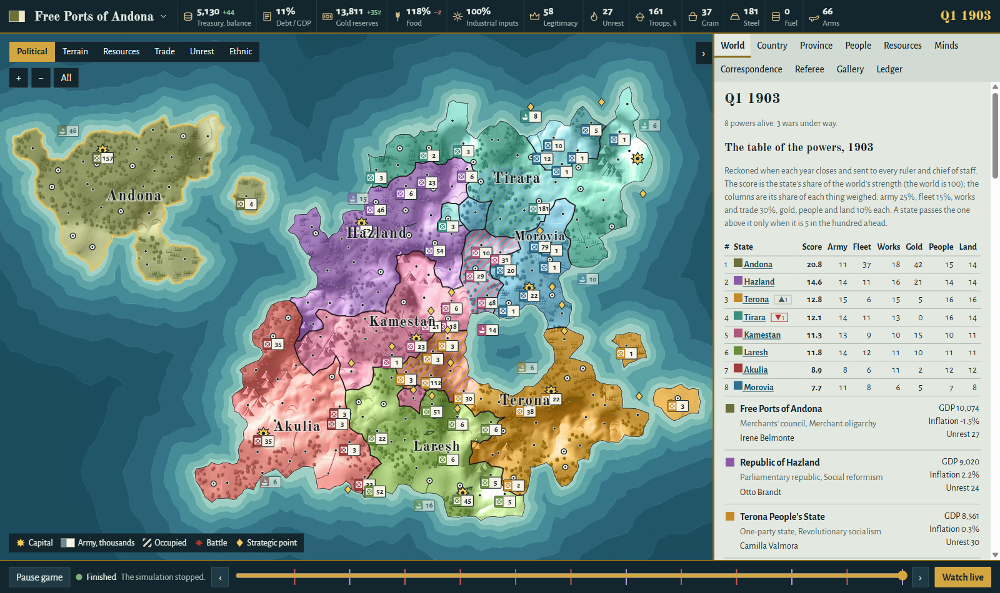

# Agentic World

**A turn-based political simulation of an invented 1900s world, in which every ruler, chief of staff, opposition leader and magnate is an AI character with a memory, an ego and a life of their own. You don't play. You watch.**



Eight states share a continent and an island on a procedurally generated map. Each state has four seats: the **ruler**, the **chief of the general staff**, the **leader of the opposition** and the **foremost magnate**. That makes 32 AI characters. Each one lives in its own persistent Claude session. Every quarter, each of them wakes up, reads the morning's report, looks up what they want to know, writes letters, bargains, and gives orders in plain language. An impartial referee turns those orders into engine operations. The engine then decides what actually happens: the economy, the war, the courts, the elections and the dead.

Nobody is given a goal, a personality or a menu of moves. Characters write who they are themselves. They can be honest or corrupt, merciful or cruel, patient or reckless. War, coups, prisons, forged papers and bought votes are as open to them as reform and keeping their word. The world answers only with consequences.

---

## What a game looks like

From a 21-year run (`world-28`, 1900–1921):

- **An empress buys her rivals.** The absolute ruler of Laresh buys up the debts of her jailed opposition leader and never uses them. She binds a hawkish general, who once burned a village and blamed it on the enemy, by naming him her heir. She writes her reforms into a fundamental law that no successor may repeal. When she dies, the general takes the throne. He keeps her peace ("nothing, carefully, for as long as it is needed"), then loses the throne at the ballot box she created.
- **Two dossiers.** A president who first came to office on a bought vote, and an opposition leader who once took money from a foreign legation, spend a decade publishing each other's secrets. One of the files turns out to be half false, and parliament passes a law protecting deputies' files 100–0. Years later the opposition leader confesses everything in her own newspaper and withdraws from public life.
- **A war from a drawer.** A junta's chief of staff keeps a plan for Brunmarka that not even her ruler knows exists. Thirteen years later, under different leaders, it is carried out: three battles, a famine across the border, five neighbours (including a rival) sending grain, and a peace the defeated president says his government "signed without reading its clauses".
- **A generation dies.** Each character's mind is its Claude session. As a session nears the model's context limit, the character falls ill. When the session is compacted, the character dies. The eight founding rulers died within a few years of each other ("the old men of this part of the world are going together, like a class leaving the seminary"). Their successors inherit the country's chronicle and the papers left on their desk, but not their predecessors' memories.

---

## How a turn works

One turn is one quarter of a year.

1. **Morning.** Each AI character receives a report written for their seat: what came of their orders, urgent matters, letters, headlines. It also includes their desk: the treasury, the army list, the frontiers, the state of the country and the world, standing orders and the people around them. What a seat can know is limited: an opposition leader knows the budget only as rumour, and foreign secrets need intelligence.
2. **Looking things up.** Characters can query the world: the map, a province, another country's yearbook, the markets, the army, a war plan, a person's file. There are about 45 topics, each answered at the asker's level of access.
3. **Talking.** Letters go to anyone in the world, by name or by office. Within the quarter there can be several rounds of replies, so deals are struck and broken before anything is ordered. A state that watches the post opens some letters on the way.
4. **Deciding.** Each character writes decisions in free text: "Call up forty thousand reservists at Akdar", "Have the police watch the general's letters", "Offer Andona iron at the world price for two years".
5. **The referee.** A separate Claude call reads every decision of a country and turns it into engine operations. The engine knows about 220 kinds. The referee does not soften orders and does not judge whether a policy is wise.
6. **The engine.** The operations are applied. An order the engine cannot carry out as written comes back to its giver the same morning, with the reason, and can be given once more. Then the world plays the quarter: production and trade, prices and debt, battles and sieges, sea power, elections, strikes, plots, illnesses and deaths.
7. **Record.** Everything is written to a searchable ledger: inner voices, letters, rulings, the engine's answers, battles and news.

---

## The world

Everything is computed. The story is what the characters do with it.

- **Economy.** Resources, mines and factories, supply chains, a world market with prices, routes overland and by sea, tariffs and quotas, gold, currencies and exchange rates, inflation, sovereign debt priced by lenders, defaults, companies with owners and dividends.
- **Land and sea war.** Offensives planned and launched by the staff, terrain, rivers, fortresses and field works, supply from railheads and depots, ammunition drawn from the arsenal, sieges, surprise, cavalry screens, sickness, reserves and mobilisation. At sea: battleships, cruisers, torpedo boats and submarines, coal and bases, blockades, mines, landings and bombardment.
- **Politics.** Legitimacy and unrest, power blocs, parties and parliaments, bills and votes of no confidence, elections (and rigging), courts and trials, a press with owners, police and informants, plots and coups, an armed underground, radical leagues, petitions, strikes and unions, succession by dynasty, army, party or council.
- **Diplomacy.** Treaties with enforceable clauses (troop limits, reparations, cessions, loans, deliveries), alliances aimed at named states, ultimatums with deadlines, conferences, mediation, secret treaties that can leak, guarantees, a record of broken promises, and a yearly table of the powers that every chancellery reads.
- **Peoples and faiths.** Mixed provinces, minority rights and the laws that deny them, schools, resettlement, persecution, kin across the border, assimilation.
- **Lives.** People age, fall ill, are wounded, jailed, exiled and executed. A fallen AI character keeps playing with what a prisoner or an exile can still do. Each country keeps a chronicle of the game years.

The opening text tells each character about the age they live in: what war meant in 1900, what people of that age believed about nations and faiths, and how seldom the people who reach such seats are saints. It never tells them what to want.

---

## Running it

You need **Node.js 20+** and a signed-in **[Claude Code](https://claude.com/claude-code)**. There are no npm dependencies.

```bash
node run.js                    # a real game with AI characters; open http://localhost:4173
node run.js --turns 50         # stop after 50 turns
node run.js --roles leader     # only the rulers are AI; the other seats play by rules
node run.js --backend mock --name demo --delay 1500   # no Claude at all: rule-based players, to try the panel
```

Characters are called through `claude -p` with persistent sessions (`--resume`), so a game runs on your Claude subscription, not the API. With all 32 seats played by AI, a turn takes about five minutes. A long game uses a lot of tokens, since every character keeps its whole life in its session.

Pause and resume from the panel. Stopping the process with Ctrl+C is safe too: the next `node run.js` continues from the last turn. `--new` deletes the save of the same name and starts over.

Saves are written outside the repository, under `<your home>/ajan-dunyasi-kayitlar/<runName>`.

### Settings (`config.json`)

| Key | What it does |
|---|---|
| `runName` | The save to open or create. |
| `seed`, `countries`, `provinces` | The map. The default is seed 2696855: eight states on 200 provinces. |
| `agentRoles`, `countryAgentRoles` | Which seats are AI, everywhere or per country. |
| `models.cast` | Models dealt by lot among the characters (default `["opus", "sonnet"]`). Every country gets each model, and a character keeps its model for life. `models.assign` pins a model to a person, seat or role. |
| `models.referee` | The referee's model. |
| `models.effort` | Reasoning effort per model. |
| `maxLookupRounds`, `negotiationRounds` | How many lookup and letter rounds a character gets each quarter. |
| `wearOut` | Context sizes at which a character falls ill (`mild`, `serious`). `false` turns mortality-by-context off. |
| `amendReturned` | Whether a refused order comes back the same morning to be given again. |
| `maxTurns` | `0` means the game never ends on its own. |

---

## The panel

A 2D map with political, terrain, resource, trade, unrest and ethnic layers, plus armies, fleets, battles and occupation. Beside it are tabs for the world, a country, a province, people, resources, the characters' inner voices (**Minds**), every letter (**Correspondence**), every ruling (**Referee**), generated portraits and scenes (**Gallery**) and the full searchable **Ledger**. A timeline slider replays any past turn.

---

## Tools

| Command | What it does |
|---|---|
| `node tests/realism.js` | About 370 realism and cause-and-effect checks. `QUICK=1` skips the slowest; `KEEP_GOING=1` lists every failure; `ONLY="word"` runs matching checks. |
| `node tools/checkup.js <save> <from> <to>` | Review a stretch of a game: broken numbers, refused orders, seats that woke with no ruling, battles, staff reports. |
| `node tools/fuzz.mjs .` | Throws hundreds of thousands of random and scripted orders at the engine across several maps, looking for crashes, impossible values and broken text. |
| `node tools/drill.mjs . all 3` | Order drill: a writer model phrases intents the way a ruler or general would, the game's own referee translates them, and each result is checked against the intent. Uses real Claude calls. |
| `node tools/balance/*.mjs .` | Balance measurements: trade, war costs, lenders' rates, land and sea combat, building returns, seed search. |
| `node tools/export.js <save>` | Exports a finished game (timeline, positions, snapshots, art) for a video-making AI. |

---

## Layout

```
run.js          launcher and local server for the panel
engine/         the world model: map and generation, economy, military, navy, politics,
                diplomacy, courts, press, culture, health, annals, and applyOp (every operation)
agents/         the turn loop, prompts, queries (what each seat may know), referee,
                rule-based players, Claude backend, saving and the ledger
panel/          the viewing app (no build step)
tests/          realism.js
tools/          checkup, fuzz, drill, export, balance measurements
docs/denetim/   audit reports of past games
CLAUDE.md       the developer handbook (in Turkish): design decisions, the history of every
                game played and what was learned from it
```

---

## Design principles

A few rules the project keeps (the full list, with the reasoning behind each, is in `CLAUDE.md`):

- **Total freedom, no menu.** Characters write what they want to do. Nothing is refused because it isn't on a list.
- **The engine decides outcomes.** Economy, battles and elections are computed, never narrated. Dice are thrown only where the engine cannot know the answer.
- **Personality is not imposed, but everyone has an ego.** There are no relationship scores and no emotion meters. Characters decide whom to trust or hate from what has happened to them.
- **Information is pulled, and access is real.** A seat learns what its position would plausibly let it learn.
- **The ruler decides, the engine only answers.** Wherever a government would set a number (a gold floor, a term of service, a lending policy), it is an order with a default, not a constant.
- **Every new mechanic touches at least two others** and comes with a cause-and-effect test.
- **Everything is visible to the watcher**: inner voices, secret letters and every ruling.

---

## Status

This is a personal research project, built and tuned over dozens of full games with real AI characters. It runs on Windows (tested on Windows 11 with Node 24) and should run anywhere Node and Claude Code do. The game text, panel and data are in English. The developer handbook is in Turkish.
